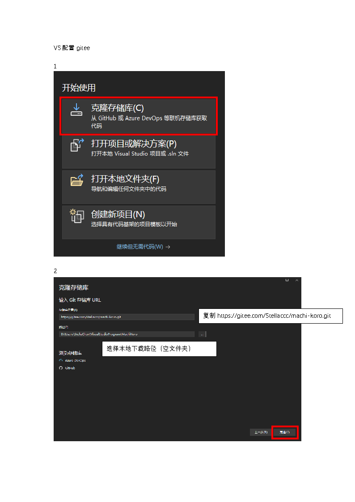
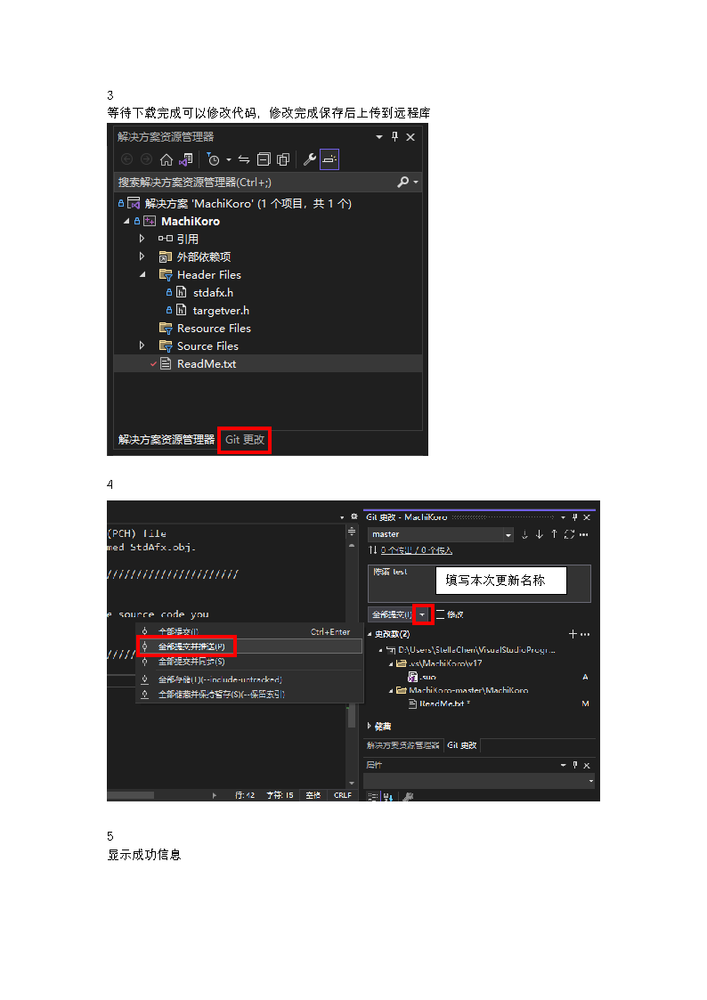
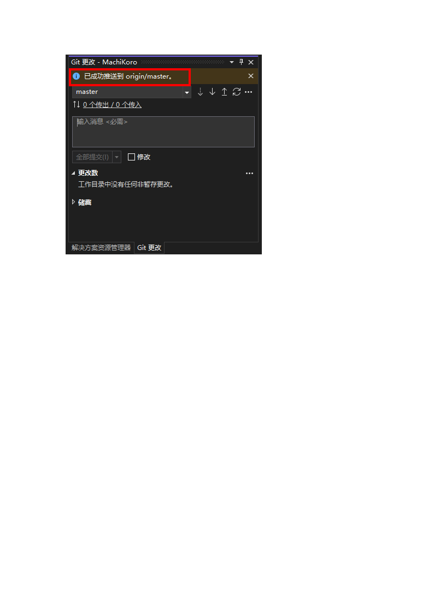
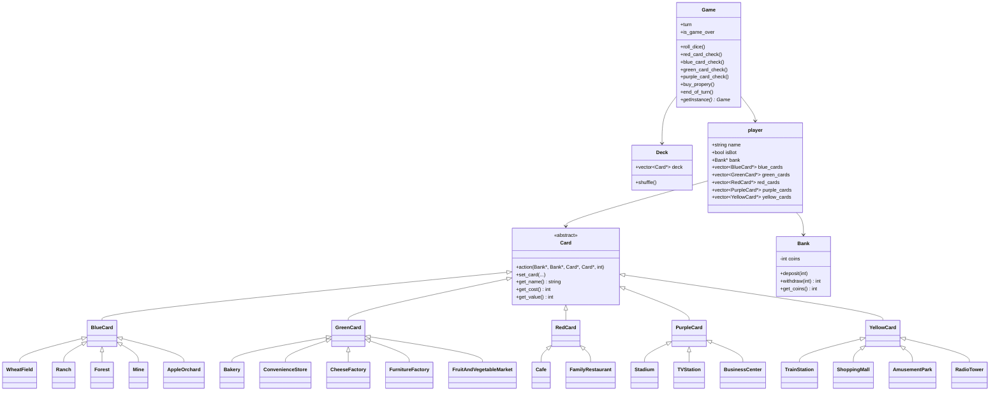

# MachiKoro

一个用 **C++ / Visual Studio** 写的《MachiKoro（街角小吃店）》控制台版实现。

游戏界面以法语提示为主，支持 1~N 名玩家，可加入 AI。玩家通过掷骰子获得金币、购买建筑，最先建齐 4 座大型建筑（地标）的玩家获胜。

> 这是早期的课程/练习项目，代码保留了不少当时的写法；本次对购买流程、卡牌结算和输入处理做了一轮集中修复，详见 [本次修复内容](#本次修复内容)。

---

## 目录

- [项目简介](#项目简介)
- [功能特性](#功能特性)
- [项目亮点](#项目亮点)
- [演示视频](#演示视频)
- [课程笔记与归档](#课程笔记与归档)
- [构建与运行](#构建与运行)
- [目录结构](#目录结构)
- [游戏规则速览](#游戏规则速览)
- [操作命令](#操作命令)
- [卡牌一览](#卡牌一览)
- [代码设计](#代码设计)
- [AI 行为](#ai-行为)
- [本次修复内容](#本次修复内容)
- [验证记录](#验证记录)
- [已知限制与 TODO](#已知限制与-todo)
- [开发环境](#开发环境)

---

## 项目简介

MachiKoro 是一款骰子驱动的轻策略桌游。每名玩家初始拥有：

- 3 枚金币
- 1 张「麦田」（Wheat Field）
- 1 张「面包店」（Bakery）
- 4 张待建造的地标：火车站、商业中心、游乐园、广播塔

每回合流程：

1. **掷骰子**：默认 1 颗；拥有火车站后可以选择 1 或 2 颗。
2. **结算收入**：按 红 → 蓝/绿 → 紫 的顺序触发卡牌效果。
3. **建造**：支付金币，建造 **1 张** 普通建筑或地标。

最先建齐 4 座地标的玩家获胜。

---

## 功能特性

- 完整的回合流程：掷骰、收入结算、购买、胜负判定。
- 五种颜色卡牌，使用虚函数 `action()` 实现多态结算。
- 支持人类玩家与 AI 混合对局。
- 支持两种市场模式：
  - `origin`：完整 15 种建筑全部进入市场。
  - `dlc`：随机抽取 10 种建筑组成市场（简化变体）。
- 控制台输入校验：非法命令、越界编号、买不起的卡都不会导致崩溃。
- 支持查看市场、查看任意玩家手牌。
- Windows 控制台表格化文本输出（使用 `setw` 对齐）。

---

## 项目亮点

- **完整的面向对象设计**：`Card` 抽象基类 + 五色卡继承体系，结算通过虚函数 `action()` 多态分发。
- **设计模式实践**：`Game` 单例、`Deck` 集中创建（简单工厂思想）、`Game::iterator` 自定义迭代器、卡牌多态结算（类似 Strategy）。
- **完整游戏规则**：15 种建筑 + 4 种地标，红/蓝/绿/紫四阶段结算，支持 1~N 名玩家与 AI 混合对局。
- **防御式输入处理**：正则解析 + 单行输入 + 越界/买不起/重复紫卡校验，异常输入不会崩溃。
- **工程化归档**：UML 设计图、课程笔记（Markdown + 原始 docx）、演示视频、旧版原型，完整保留项目演进过程。

---

## 演示视频

| 场景 | 时长 | 视频 |
| --- | ---: | --- |
| DLC 模式胜利 | 12 秒 | [▶ 观看](docs/demo/dlc_win.mp4) |
| 起源模式胜利 | 16 秒 | [▶ 观看](docs/demo/origin_win.mp4) |
| DLC 模式购买流程 | 59 秒 | [▶ 观看](docs/demo/dlc_buy.mp4) |

> 点击链接后可在 GitHub 的文件页面播放/下载。较长或重复的原始录像（4 分钟起源模式、1 分钟 DLC 备份）放在 [`archive/videos/`](archive/videos/)，作为资料归档。

---

## 课程笔记与归档

- [课程笔记整理（Markdown）](docs/course-notes.md)：按 OOP、C++、UML、设计模式、STL、考点分类整理。
- [原始课程笔记（docx）](archive/course-notes/课程笔记.docx)：完整原始文件，保留不动。
- [旧版原型 v0.1](archive/legacy-v0.1/README.md)：2022-10 的早期实现，仅作版本演进记录。
- [完整演示录像](archive/videos/)：较长的原始录屏，作为归档。

---

## 构建与运行

### 方式一：Visual Studio

1. 打开解决方案：
   ```
   MachiKoro-master/MachiKoro.sln
   ```
2. 选择 `Debug|x64` 或 `Release|x64`。
3. 按 `F5` 或 `Ctrl+F5` 运行。

项目使用预编译头 `stdafx.h`，工具集为 `v143`（VS2022）。如果使用更早的 VS 版本，可能需要在项目属性里调整 `PlatformToolset`。

### 方式二：命令行编译（MinGW / g++）

在 `MachiKoro-master/MachiKoro` 目录下：

```bash
g++ -std=c++14 -I. Card.cpp Bank.cpp BlueCard.cpp GreenCard.cpp \
    RedCard.cpp PurpleCard.cpp YellowCard.cpp Deck.cpp Game.cpp \
    MachiKoro.cpp -o MachiKoro.exe
```

> 代码只依赖标准库和 Windows 控制台的 `system("cls")`，因此在 Linux/macOS 上编译时需要把清屏命令替换掉。

### 从 Gitee 拉取到 Visual Studio





---

## 目录结构

```text
Machikoro/
├─ MachiKoro-master/          # 当前可玩版本
│  ├─ MachiKoro.sln
│  └─ MachiKoro/
│     ├─ MachiKoro.cpp        # 程序入口与主循环
│     ├─ Game.h / Game.cpp    # 游戏流程、结算、购买、AI、输入解析
│     ├─ Card.h / Card.cpp    # 卡牌抽象基类
│     ├─ BlueCard.*           # 蓝色卡（初级产业）
│     ├─ GreenCard.*          # 绿色卡（二级产业）
│     ├─ RedCard.*            # 红色卡（餐饮）
│     ├─ PurpleCard.*         # 紫色卡（大型建筑）
│     ├─ YellowCard.*         # 黄色卡（地标）
│     ├─ Deck.h / Deck.cpp    # 牌堆：集中创建全部卡牌并洗牌
│     ├─ Bank.h / Bank.cpp    # 玩家钱包
│     ├─ ColorAndIcon.h       # 颜色与图标枚举
│     ├─ stdafx.*             # 预编译头
│     └─ targetver.h
├─ docs/
│  ├─ demo/                   # README 展示用短视频
│  │  ├─ origin_win.mp4
│  │  ├─ dlc_win.mp4
│  │  └─ dlc_buy.mp4
│  └─ course-notes.md         # 课程笔记整理（Markdown）
├─ archive/
│  ├─ legacy-v0.1/            # 2022-10 旧版原型（仅源码入库）
│  ├─ course-notes/           # 原始课程笔记 docx
│  └─ videos/                 # 完整/备份录像
├─ cardImages/                # BMP 卡面素材（当前控制台版本未使用）
├─ UML.vsdx / UML.pdf         # UML 设计图
├─ UML_黑白.pdf
├─ .gitignore                 # 忽略 VS 构建产物
└─ README.md
```

> `archive/legacy-v0.1/` 中保留了旧版原型的完整本地文件，但 `.vs/`、`x64/`、`*.obj`、`*.exe`、`*.pdb` 等构建产物已被 `.gitignore` 排除，不会提交到 GitHub。

---

## 游戏规则速览

### 回合流程

1. **掷骰子**
   - 未拥有火车站：只能掷 1 颗。
   - 拥有火车站：可选择 1 颗或 2 颗。
2. **收入结算**（所有玩家都会参与）：
   - **红色（餐饮）**：掷骰者向其他拥有红卡的玩家付钱。
   - **蓝色（初级产业）**：所有拥有对应蓝卡的玩家从银行收钱。
   - **绿色（二级产业）**：只有当前玩家结算，部分卡按图标数量倍增收钱。
   - **紫色（大型建筑）**：只在点数为 6 时触发。
3. **建造阶段**：当前玩家可以购买 **1 张** 普通建筑或地标。
4. **结束回合**：若拥有游乐园且掷出对子，可额外进行一回合。

### 颜色说明

| 颜色 | 类型 | 触发方式 |
| --- | --- | --- |
| 蓝色 | 初级产业 | 任意玩家回合，点数匹配时收钱 |
| 绿色 | 二级产业 | 仅当前玩家回合，点数匹配时收钱 |
| 红色 | 餐饮 | 任意玩家回合，向掷骰者收钱 |
| 紫色 | 大型建筑 | 当前玩家点数匹配时触发特殊效果 |
| 黄色 | 地标 | 购买后永久生效，不参与点数结算 |

### 胜利条件

率先建造全部 4 座地标：

- 火车站（Train Station，4）
- 商业中心（Shopping Mall，10）
- 游乐园（Amusement Park，16）
- 广播塔（Radio Tower，22）

> 地标可以按任意顺序建造，没有前置条件。

---

## 操作命令

游戏开始时会先询问：

- `origin`：完整市场（15 种建筑）
- `dlc`：随机 10 种建筑

然后输入玩家人数、AI 人数和玩家名称。

建造阶段的可用命令：

| 命令 | 作用 |
| --- | --- |
| `no` | 结束本回合的建造阶段 |
| `voir tableau` | 查看市场（`voir table` 也可） |
| `voir N` | 查看第 N 位玩家的手牌 |
| `acheter N` | 购买市场 N 号卡牌 |
| `acheter TrainStation` | 购买火车站（4 金币） |
| `acheter ShoppingMall` | 购买商业中心（10 金币） |
| `acheter AmusementPark` | 购买游乐园（16 金币） |
| `acheter RadioTower` | 购买广播塔（22 金币） |

其他提示：

- 拥有火车站后，掷骰前会询问 `1 ou 2 dés :`，输入 `1` 或 `2`。
- 拥有广播塔后，可输入 `y` / `n` 决定是否重掷一次。
- 紫卡「电视台」会让你选择一名其他玩家；「商业中心」会让你选择交换的玩家和卡牌。
- 所有选择都可以输入 `no` 取消（适用时）。

---

## 卡牌一览

### 蓝色卡（初级产业）

| 卡牌 | 费用 | 触发点数 | 收益 |
| --- | ---: | ---: | --- |
| Wheat Field（麦田） | 1 | 1 | +1 |
| Ranch（牧场） | 1 | 2 | +1 |
| Forest（森林） | 3 | 5 | +1 |
| Mine（矿山） | 6 | 9 | +3 |
| Apple Orchard（苹果园） | 3 | 10 | +1 |

### 绿色卡（二级产业）

| 卡牌 | 费用 | 触发点数 | 收益 |
| --- | ---: | ---: | --- |
| Bakery（面包店） | 1 | 2~3 | +1 |
| Convenience Store（便利店） | 2 | 4 | +3 |
| Cheese Factory（奶酪工厂） | 5 | 7 | 每张牛图标 +3 |
| Furniture Factory（家具工厂） | 3 | 8 | 每张齿轮图标 +3 |
| Fruit & Vegetable Market（果蔬市场） | 2 | 11~12 | 每张谷物图标 +2 |

> 绿色卡的倍率图标来自 `set_multiplier_icon()`，与卡牌自身图标分开存储。

### 红色卡（餐饮）

| 卡牌 | 费用 | 触发点数 | 收益 |
| --- | ---: | ---: | --- |
| Cafe（咖啡馆） | 2 | 3 | 从掷骰者拿 1 |
| Family Restaurant（家庭餐厅） | 3 | 9~10 | 从掷骰者拿 2 |

### 紫色卡（大型建筑）

| 卡牌 | 费用 | 触发点数 | 效果 |
| --- | ---: | ---: | --- |
| Stadium（体育场） | 6 | 6 | 向其他每名玩家各收 2 |
| TV Station（电视台） | 7 | 6 | 选择一名其他玩家，拿 5 |
| Business Center（商业中心） | 8 | 6 | 与一名其他玩家交换一张非紫卡 |

### 黄色卡（地标）

| 地标 | 费用 | 效果 |
| --- | ---: | --- |
| Train Station（火车站） | 4 | 可选择掷 1 或 2 颗骰子 |
| Shopping Mall（购物中心） | 10 | 红卡和绿卡收益各 +1 |
| Amusement Park（游乐园） | 16 | 掷出对子后额外获得一回合 |
| Radio Tower（广播塔） | 22 | 每回合可重掷一次骰子 |

---

## 代码设计

### 类关系



### 设计要点

- **多态结算**：`Card::action()` 是纯虚函数，不同颜色/卡牌在子类里实现自己的收付款逻辑。`Game` 只负责判断点数是否命中，然后调用 `action()`。
- **简单工厂**：`Deck` 构造函数集中创建全部卡牌，外部只拿到 `Card*` 列表。
- **单例**：`Game::getInstance()` 保证全局只有一个游戏实例；主循环通过它访问游戏状态。
- **迭代器**：`Game` 内部定义了一个基于 `vector<vector<Card*>>::iterator` 的迭代器，目前主要用于遍历市场；实际视图代码仍大量使用下标访问。
- **玩家钱包**：`Bank` 表示一名玩家的金币，不是中央银行；银行本身不模拟金币总量。
- **输入解析**：`Game::player_input()` 用正则表达式解析命令，`normalize()` 负责压缩空白，`ask_int()` 负责单行整数输入。

---

## AI 行为

AI 的设计目标不是“强”，而是“能自己完整打完一局”：

- 掷骰：拥有火车站时固定选择 2 颗骰子。
- 广播塔：点数 ≤ 4 时自动重掷一次。
- 建造：只会在“买得起、且不是已拥有的紫卡”的选项中随机选择。
- 地标：买得起就会纳入候选。
- 电视台：选择金币最多的其他玩家。
- 商业中心：随机选择目标玩家和双方各一张非紫卡进行交换。

AI 每回合同样只能建造 1 张，和人类玩家一致。

---

## 本次修复内容

本次主要针对“能玩、不崩溃、规则正确”做了一轮集中修复：

### 购买流程

- 修复黄卡购买返回值错误：原来会把“剩余金币数”当作卡槽下标返回，可能白拿卡或越界；现在使用明确的 `YELLOW_PURCHASE` 返回值。
- 修复 `slot[0]` 永远无法购买的问题。
- 修复“先扣钱、后校验”的问题：现在紫卡重复、金币不足都会在扣钱前拦截。
- 保持官方规则：**每回合只能建造 1 张**（普通建筑或地标）。
- 修复卡槽下标越界判断（`>` 改为 `>=`）。
- AI 不再使用固定 `rand() % slotnum`，而是基于实际市场大小选择。

### 卡牌结算

- 紫卡效果现在只在点数为 **6** 时触发。
- Stadium 不再向自己收钱，只向其他玩家收取。
- TV Station / Business Center 改用 `dynamic_cast` 识别，避免字符串名称不一致导致效果永远不触发。
- 修复 Business Center 交换界面里 `for` 循环条件写错变量（`i` / `k`）导致的死循环和越界。
- Shopping Mall 现在使用正确的地标下标（`yellow_cards[1]`），并作用于红卡/绿卡。
- 绿色卡的倍率改为读取 `get_multiplier_icon()`，修复奶酪工厂、家具工厂、果蔬市场此前倍率恒为 0 的问题。
- `Bank::withdraw()` 在余额不足时返回实际扣除的金币数，不再让金币凭空消失。
- 地标可以按任意顺序建造，移除了错误的前置条件。
- 游乐园只在掷出对子时额外获得回合。

### 输入与稳定性

- 修复 `voir table` 会触发 `stoi("table")` 异常的问题；现在 `voir table` / `voir tableau` 都可正常查看市场。
- 支持多位数卡槽编号（不再限制 0~9）。
- 统一使用 `getline` 输入，消除 `cin >>` 与 `getline` 混用导致的空行问题。
- 输入会先 trim + 压缩连续空格，减少“看起来一样但匹配不上”的情况。
- 增加 EOF 处理：管道输入结束时游戏会正常退出，不会无限循环。
- 主循环不再依赖 `system("pause")` 读取按键，改为等待回车，避免输入缓冲区残留换行。

### 代码质量

- `Card` 的成员变量增加默认初始化，避免未初始化值。
- `Card` 增加虚析构函数。
- `Card::set_card()` 声明与定义的 `cost/value` 参数顺序统一。
- `random_shuffle` 替换为 `std::shuffle` + `std::mt19937`。
- 清理了未使用的 `slot_count`、重复洗牌、主函数中的死代码。
- 增加空卡槽防护，避免访问 `slot[i][0]` 时越界。

---

## 验证记录

本次修改后做了以下验证（临时脚本已删除，不污染仓库）：

- 使用 `g++ -std=c++14 -fsyntax-only` 对全部 `.cpp` 做语法检查，通过。
- 使用 `g++ -std=c++14` 完整链接生成可执行文件，通过。
- 用脚本输入跑过 `dlc` 模式的人类对局，验证了市场查看、玩家查看、非法编号、买不起、成功购买、回合结束等流程。
- 用脚本输入跑过 1 人类 + 1 AI 对局，AI 能自动掷骰、重掷和购买。
- 临时单元测试验证了以下数值：
  - `Bank::withdraw()` 余额不足时返回实际扣款。
  - `CheeseFactory`：3 × 牛图标数量。
  - `FruitAndVegetableMarket`：2 × 谷物图标数量。
  - `Bakery`：基础 1 金币。
  - `Stadium`：从其他玩家各拿 2 金币。

---

## 已知限制与 TODO

- 仅支持 Windows 控制台：`system("cls")` 是 Windows 专用。
- 视图和游戏逻辑仍集中在 `Game` 中，后续可以拆成 `Game` + `View` / `Controller`。
- 所有卡牌、玩家、`player` 对象使用 `new` 创建，进程退出时由操作系统回收；若长期运行或做单元测试，建议补 `delete` 或改用智能指针。
- 单例实现不是线程安全的。
- Shopping Mall 目前对**所有**红卡和绿卡加 1；标准规则更细，只对 Restaurant / Bakery 类卡牌生效，后续可以按图标进一步区分。
- AI 只做“买得起就随机买”，没有针对对手卡组、骰子分布做策略优化。
- `cardImages/` 中的 BMP 素材尚未接入，当前是纯文本界面。
- `dlc` 只是“随机 10 种建筑”的市场变体，不是真正的扩展包规则。
- 尚无存档/读档、回放、单元测试工程；本次仅用临时脚本做了编译和冒烟验证。

---

## 开发环境

- 语言：C++（C++14 及以上）
- IDE：Visual Studio 2022（v143）
- 平台：Windows 控制台（Win32 / x64）
- 构建系统：MSBuild（`MachiKoro.sln`）
- 依赖：仅 C++ 标准库

---

## 备注

：这里可以随意留言 XD
